# Cheap Delivery

* [Overview](#overview)
    - [Flow](#flow)
    - [Use cases](#use-cases)
    - [Queries](#queries)
    - [Health checks](#health-checks)
* [Installation](#installation)
    - [Repository](#repository)
    - [Configuration](#configuration)
    - [Tests](#tests)
    - [Review](#review)
    - [Reports](#reports)
* [Environment setup](#environment-setup)
    - [Access URLs](#access-urls)
    - [Environment variables](#environment-variables)

## Overview

Company XPTO held a drawing among players from all over Brazil, and the prizes have to reach the winners. This service
calculates the lowest shipping cost for each prize from the distance to the winner and the weight of the prize, records
the dispatch against the carrier that charges the least, and publishes the fact through a transactional outbox.

Every carrier prices a shipment through the cost modality it declares. A modality is a fixed amount, a rate per
kilometre and kilogram, a band restricted to a weight range, or a composition of those. The carriers the service ships
with are seeded by the migrations:

| Carrier            | Fixed value | Value per km/kg |
|:-------------------|------------:|----------------:|
| DHL                |    R$ 10,00 |         R$ 0,05 |
| FedEx              |     R$ 4,30 |         R$ 0,12 |
| Loggi (up to 5kg)  |     R$ 2,10 |         R$ 1,10 |
| Loggi (5kg and up) |    R$ 10,00 |         R$ 0,01 |

The HTTP contract is published in `openapi.yaml` at the repository root and detailed in the documentation pages linked
below. To exercise it, import the [Postman collection](docs/postman/cheap-delivery.postman_collection.json). It covers
every operation, and running it top to bottom against a local stack dispatches a prize and reads the result back. It
carries its own `baseUrl`, so no environment import is needed to point it at `http://cheap-delivery.localhost:8190`.

### Flow





The domain events view shows the commands that raise each event and the aggregate that owns it. No consumer reacts
to them yet.

Sources: [cheap-delivery-flow.html](docs/diagrams/cheap-delivery-flow.html),
[cheap-delivery-events.html](docs/diagrams/cheap-delivery-events.html).

### Use cases

- [Dispatch with the lowest cost](docs/USE_CASES.md#dispatch-with-the-lowest-cost)

### Queries

- [Find dispatches](docs/QUERIES.md#find-dispatches)

### Health checks

- [Liveness check](docs/HEALTH.md#liveness-check)
- [Readiness check](docs/HEALTH.md#readiness-check)

## Installation

### Repository

To clone the repository using the command line, run:

```bash
git clone https://github.com/gustavofreze/cheap-delivery.git
```

### Configuration

To install project dependencies locally, run:

```bash
make configure
```

To update dependencies and normalize `composer.json`, run:

```bash
make configure-and-update
```

To start the application containers, run:

```bash
make start
```

To stop the application containers and drop the data volume, run:

```bash
make stop
```

### Tests

Run all tests with coverage and mutation testing:

```bash
make tests
```

Run a specific test file without coverage:

```bash
make test-file FILE=DispatchTest
```

### Review

Run static code analysis:

```bash
make review
```

Fix what static code analysis can correct:

```bash
make fix-review
```

### Reports

Open coverage and mutation reports in the browser:

```bash
make show-reports
```

Show outdated direct dependencies:

```bash
make show-outdated
```

> You can check other available commands by running `make help`.

## Environment setup

### Access URLs

| Environment | DNS                                  |
|:------------|:-------------------------------------|
| `Local`     | http://cheap-delivery.localhost:8190 |

### Environment variables

Every variable the application and its migration run read. This is a proof of concept, so `.env.local` is committed at
the repository root and the `Development value` column below is the literal content of that file. Every value in it is a
local-only default and never a real credential. A deployed environment supplies its own values through the container
environment instead. The `Makefile` hands the file to Docker Compose with `--env-file`, and both the `cheap-delivery`
and the `cheap-delivery-migrate` services load it through `env_file`.

| Variable                           | Description                                                             | Development value                                                                                                             |
|:-----------------------------------|:------------------------------------------------------------------------|:------------------------------------------------------------------------------------------------------------------------------|
| `DEBUG`                            | Whether error responses carry the exception details                     | `false`                                                                                                                       |
| `SOURCE`                           | Address the root path redirects to                                      | `https://github.com/gustavofreze/cheap-delivery`                                                                              |
| `APP_NAME`                         | Component name every log entry carries                                  | `cheap-delivery`                                                                                                              |
| `DATABASE_HOST`                    | Database host (docker service name)                                     | `cheap-delivery-adm`                                                                                                          |
| `DATABASE_PORT`                    | Database port inside the compose network, published on the host as 3406 | `3306`                                                                                                                        |
| `DATABASE_NAME`                    | Schema the application reads and writes                                 | `cheap_delivery_adm`                                                                                                          |
| `DATABASE_USER`                    | Database user the application connects as                               | `root`                                                                                                                        |
| `DATABASE_PASSWORD`                | Password of the application user                                        | `root`                                                                                                                        |
| `FLYWAY_URL`                       | JDBC URL the migration run connects to                                  | `jdbc:mysql://cheap-delivery-adm:3306/cheap_delivery_adm?allowPublicKeyRetrieval=true&useUnicode=yes&characterEncoding=UTF-8` |
| `FLYWAY_USER`                      | Database user the migration run connects as                             | `root`                                                                                                                        |
| `FLYWAY_TABLE`                     | Table Flyway keeps its schema history in                                | `schema_history`                                                                                                              |
| `FLYWAY_SCHEMAS`                   | Schema the migrations are applied to                                    | `cheap_delivery_adm`                                                                                                          |
| `FLYWAY_PASSWORD`                  | Password of the migration user                                          | `root`                                                                                                                        |
| `FLYWAY_LOCATIONS`                 | Directory the migration files are read from                             | `filesystem:/flyway/sql`                                                                                                      |
| `FLYWAY_CLEAN_DISABLED`            | Blocks `flyway clean` from dropping the schema                          | `false`                                                                                                                       |
| `FLYWAY_VALIDATE_MIGRATION_NAMING` | Fails the migration run when a file name breaks the Flyway convention   | `true`                                                                                                                        |
